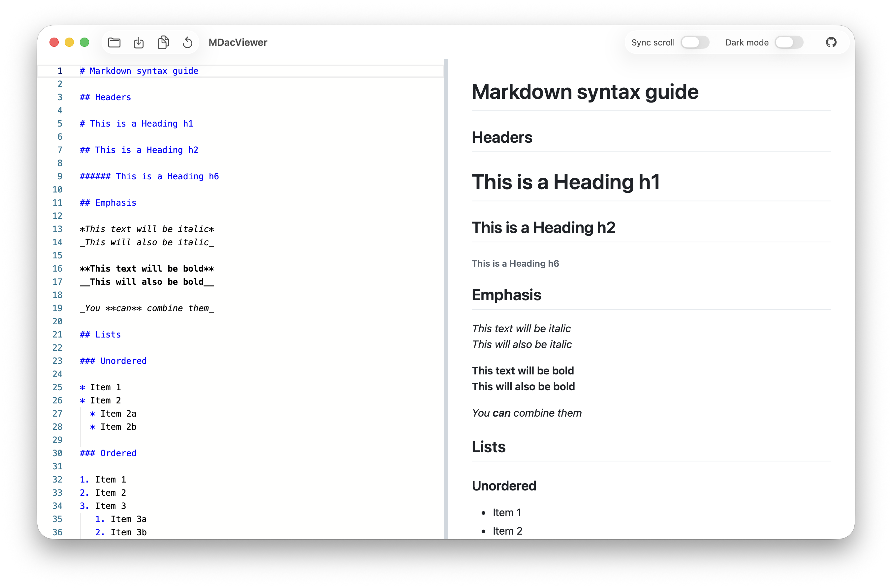
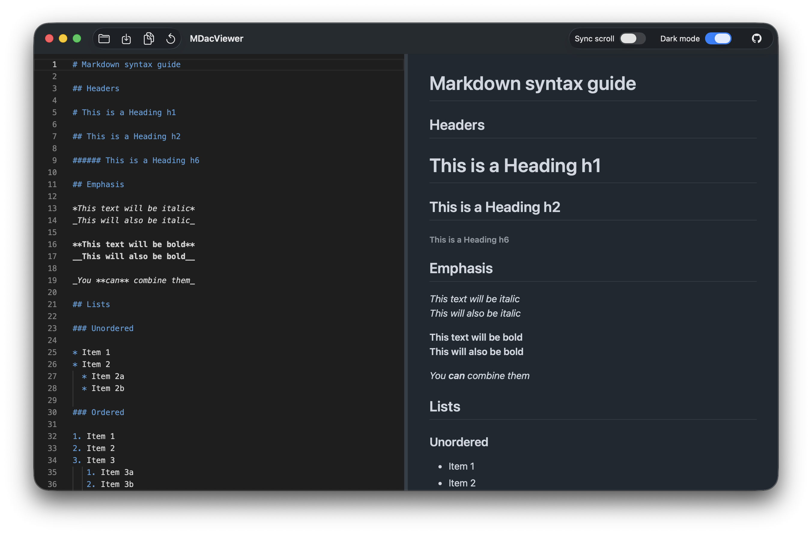

# MDacViewer

**A tiny offline macOS app for Markdown, with live preview.**

Type or paste Markdown on the left; watch it render on the right — tables, code blocks, blockquotes and [Mermaid](https://mermaid.js.org) diagrams included — instantly, without saving anything. It is essentially an offline desktop version of [markdownlivepreview.com](https://markdownlivepreview.com/), built natively for Apple Silicon Macs.

[](https://github.com/SrHayward/MDacViewer/releases/latest)
[](LICENSE)
[](#download--install)



*Dark mode — which switches the entire app, window chrome included:*



## Features

- **Live preview** — renders as you type; no file or save needed
- **Open & save `.md` files** (⌘O / ⌘S), or just work with pasted text
- **Unsaved-changes guard** — an asterisk in the title marks edits to an open file (⌘S clears it), and closing the window or quitting (⌘Q) asks Save / Don't Save / Cancel first
- **Sync scroll** — the editor and preview scroll together (toggleable)
- **Dark mode** — switches the **entire app** between light and dark: window, toolbar and both panes (toggleable)
- **Reset** — clears the editor, behind an “Are you sure?” confirmation
- **Copy** — copies the full Markdown source to the clipboard
- **Settings memory** — your dark-mode and sync-scroll settings come back when you reopen the app
- **GitHub-flavoured Markdown** — tables, strikethrough, nested lists, blockquotes and more
- **Mermaid diagrams** — <code>```mermaid</code> blocks render as live diagrams
- **Open from Finder** — double-click a `.md` file (or drag it onto the app) to open it
- **Version & update check** — the About window shows the current version, and a quiet once-a-day check shows a toolbar icon when a newer release exists (no auto-download, no auto-install)
- **Offline & private** — no analytics, no telemetry; your text never leaves your Mac. The only automatic request is the once-a-day update check (see [Privacy](#privacy)).
- Native Mac app built with SwiftUI — small (~18 MB), fast, native menus and shortcuts

## Download & install

1. Go to the [**Releases page**](https://github.com/SrHayward/MDacViewer/releases/latest) and download `MDacViewer-1.0.1.dmg` (or newer).
2. Open the DMG and drag **MDacViewer** into your **Applications** folder.
3. Launch it from Applications or Spotlight.

### First launch — please read

The app is not notarised by Apple (that requires a paid Apple Developer account), so the very first launch shows a “*Apple could not verify…*” warning. This is normal for free, open-source Mac apps. To get past it — **one time only**:

- **Right-click** (or Control-click) the app → **Open** → click **Open** again; or
- Open **System Settings → Privacy & Security**, scroll down, and click **Open Anyway** next to the MDacViewer message.

After that it launches like any other app.

> **Requirements:** an Apple Silicon Mac (M1 or newer) running **macOS 13 Ventura** or later.

## Keyboard shortcuts

| Shortcut | Action |
| --- | --- |
| ⌘O | Open a Markdown file |
| ⌘S | Save — back to the opened file, or ask where to save pasted text |
| ⇧⌘S | Save As |
| ⇧⌘C | Copy the **full** Markdown source |
| ⌘C / ⌘V | Copy / paste the selected text as usual |
| ⌘F | Find in the editor |
| ⌘Z / ⇧⌘Z | Undo / redo |
| ⌘A | Select all |
| ⌘W / ⌘Q | Close window / quit |

## Privacy

MDacViewer is offline-first. It bundles everything it needs (see credits below) — no fonts, no analytics, no telemetry, and your text never leaves your Mac.

There is exactly one automatic network request: about once a day the app asks GitHub's public API (`api.github.com`) for the newest MDacViewer release, so it can show a subtle “update available” icon in the toolbar. The request carries nothing about you — just the app's name and version — and the result is stored locally. The About window also has a **Check for Updates** button if you want to check on demand. Nothing is ever downloaded or installed automatically.

Everything else that opens a network connection is when **you** click a link in your Markdown (it opens in your default browser) or one of the GitHub buttons.

## Build from source

Requirements: an Apple Silicon Mac with either Xcode **or** just the Command Line Tools (`xcode-select --install`) — Swift 5.9+ is included with both. No other dependencies.

```bash
git clone https://github.com/SrHayward/MDacViewer.git
cd MDacViewer
make run      # builds MDacViewer.app and launches it
make dmg      # creates dist/MDacViewer-1.0.1.dmg (drag-to-install)
```

| Command | What it does |
| --- | --- |
| `make run` | Build and launch the app |
| `make app` | Build `build/MDacViewer.app` |
| `make dmg` | Build the DMG installer into `dist/` |
| `make vendor` | (Re-)download the pinned rendering libraries into `Web/vendor/` |
| `make icon` | Regenerate the app icon |
| `make clean` | Delete all build output |

The rendering libraries in `Web/vendor/` are pinned and committed, so a fresh clone builds offline with no downloads.

**Project layout:** `Sources/MDacViewer/` (native SwiftUI shell) · `Web/` (editor + preview engine) · `Scripts/` (build, DMG, icon and test tooling) · `.github/workflows/release.yml` (automated releases).

## Releases & versioning

Releases are fully automated with GitHub Actions. When a version tag such as `v1.0.1` is pushed, a GitHub-hosted Apple Silicon Mac builds the app, packages it into a DMG and publishes it on the [Releases page](https://github.com/SrHayward/MDacViewer/releases) — so every release is reproducible from source.

## Credits & license

MDacViewer would not exist without these excellent open-source projects, all bundled offline:

- [marked](https://github.com/markedjs/marked) — Markdown → HTML
- [DOMPurify](https://github.com/cure53/DOMPurify) — HTML sanitising
- [mermaid](https://github.com/mermaid-js/mermaid) — diagrams
- [github-markdown-css](https://github.com/sindresorhus/github-markdown-css) — GitHub-style themes
- [Monaco Editor](https://github.com/microsoft/monaco-editor) — the editor pane

See [THIRD-PARTY-NOTICES.md](THIRD-PARTY-NOTICES.md) for details.

MDacViewer is inspired by [markdownlivepreview.com](https://markdownlivepreview.com/) ([source](https://github.com/tanabe/markdown-live-preview), MIT) and is **not affiliated with or endorsed by it**.

Released under the [Apache License 2.0](LICENSE).

### Development note — built with AI

This project was designed and implemented with substantial assistance from AI coding tools (the [OpenCode](https://opencode.ai) agent harness). All code has been reviewed, tested and is maintained by the repository owner.
