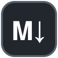
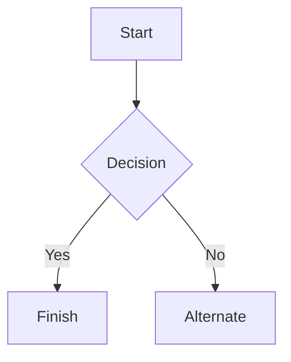

# Markdown syntax guide

## Headers

# This is a Heading h1

## This is a Heading h2

###### This is a Heading h6

## Emphasis

*This text will be italic*  
_This will also be italic_

**This text will be bold**  
__This will also be bold__

_You **can** combine them_

## Lists

### Unordered

* Item 1
* Item 2
  * Item 2a
  * Item 2b

### Ordered

1. Item 1
2. Item 2
3. Item 3
   1. Item 3a
   2. Item 3b

## Images



## Links

You may be using [MDacViewer](https://github.com/SrHayward/MDacViewer).

## Blockquotes

> Markdown is a lightweight markup language with plain-text-formatting syntax, created by John Gruber with Aaron Swartz.
>
> It is often used to format readme files, to write messages in online discussion forums, and to create rich text using a plain text editor.

## Tables

| Left columns  | Right columns |
| ------------- |:-------------:|
| left foo      | right foo     |
| left bar      | right bar     |
| left baz      | right baz     |

## Blocks of code

```js
let message = 'Hello world';
alert(message);
```

## Mermaid diagrams



## Inline code

This app renders Markdown **live as you type**. Paste your own Markdown into the left pane and watch it appear here — no file or save needed.
